<p align="center">
  <picture>
    <source media="(prefers-color-scheme: dark)" srcset="https://raw.githubusercontent.com/dioxuspress/dioxuspress/main/assets/images/logo-dark.png" />
    <source media="(prefers-color-scheme: light)" srcset="https://raw.githubusercontent.com/dioxuspress/dioxuspress/main/assets/images/logo-light.png" />
    
  </picture>
</p>

<h3 align="center">Pure-Rust Dioxus 0.7 &amp; Local AI Open-Source Ecosystem</h3>

<p align="center">
  Fullstack documentation &amp; community engine, 100 accessible shadcn/ui components, zero-backend WebAssembly developer labs, and offline hybrid code search — all written in Rust.
</p>

<p align="center">
  <a href="https://dioxuspress.dev"><strong>Website &amp; Docs</strong></a>
  &nbsp;·&nbsp;
  <a href="https://ui.dioxuspress.dev"><strong>UI Showcase (100 Components)</strong></a>
  &nbsp;·&nbsp;
  <a href="https://rustineverything.app"><strong>Rust in Everything</strong></a>
  &nbsp;·&nbsp;
  <a href="https://crates.io/crates/dioxus-shadcn"><strong>crates.io</strong></a>
</p>

---

## Ecosystem Architecture

<p align="center">
  <picture>
    <source media="(prefers-color-scheme: dark)" srcset="https://raw.githubusercontent.com/dioxuspress/.github/main/profile/ecosystem.dark.svg" />
    <source media="(prefers-color-scheme: light)" srcset="https://raw.githubusercontent.com/dioxuspress/.github/main/profile/ecosystem.light.svg" />
    
  </picture>
</p>

---

## Repositories

| Repository | Category | Highlights | Live / Package |
| :--- | :--- | :--- | :--- |
| [**`dioxuspress`**](https://github.com/dioxuspress/dioxuspress) | Fullstack Engine | Pure-Rust docs, blog &amp; community framework on Dioxus 0.7, Axum &amp; Tantivy. Zero-database `basic` tier or opt-in OAuth2, forums, annotations &amp; courses. | [dioxuspress.dev](https://dioxuspress.dev) · [rustineverything.app](https://rustineverything.app) |
| [**`dioxus-ui`**](https://github.com/dioxuspress/dioxus-ui) | UI Design System | **100** shadcn/ui-style components for Dioxus 0.7 — headless accessible primitives, Tailwind CSS v4 styling, `dxui` source-copy CLI &amp; Cargo crate (`dioxus-shadcn`). | [ui.dioxuspress.dev](https://ui.dioxuspress.dev) · [crates.io](https://crates.io/crates/dioxus-shadcn) |
| [**`dioxus-trace-viewer`**](https://github.com/dioxuspress/dioxus-trace-viewer) | Observability | Zero-backend Rust `tracing` JSONL &amp; training benchmark waterfall profiler with P50/P95/P99 histograms and anomaly triage (Web WASM + Native Desktop). | [Live Profiler](https://dioxuspress.github.io/dioxus-trace-viewer/) · [Case Study](https://rustineverything.app/case/dioxus-trace-viewer) |
| [**`rust-tensor-lens`**](https://github.com/dioxuspress/rust-tensor-lens) | Interactive LLM Lab | 100% client-side Rust/WASM interactive lab for RoPE/YaRN extrapolation, INT8/INT4/NF4/1.58-bit quantization, Byte-Level BPE stepping &amp; LLM VRAM budgeting. | [Live Lab](https://dioxuspress.github.io/rust-tensor-lens/) · [Case Study](https://rustineverything.app/case/rust-tensor-lens) |
| [**`rie-grep`**](https://github.com/dioxuspress/rie-grep) | Local AI CLI | Single-binary offline hybrid code search engine in pure Rust: Tantivy 0.27 BM25 + Candle 0.11 (CPU / Apple Metal) dense vectors + RRF fusion, with JSON output for AI Agents &amp; MCP. | [Case Study](https://rustineverything.app/case/rie-grep) |

---

## Quick Start

```bash
# Install the dxui CLI to scaffold dioxus-shadcn components into any Dioxus 0.7 app
cargo install dioxus-shadcn-cli
dxui init && dxui add button dialog command

# Or depend on the packaged crate directly
cargo add dioxus-shadcn

# Install rie-grep for offline hybrid code search (BM25 + Candle Dense + RRF)
cargo install --git https://github.com/dioxuspress/rie-grep
rie-grep index . && rie-grep search "zero downtime reload" -p .
```

---

## Engineering Baseline

Every project under `dioxuspress` shares the same production standards:

- **Pure-Rust First** — Built on Rust Edition 2024 and Dioxus 0.7 with zero Python/Node runtime dependencies in production binaries.
- **Strict Security &amp; CSP** — Web and WASM apps run cleanly under strict Content-Security-Policy with zero `'unsafe-eval'`.
- **Reliability by Construction** — `cargo clippy --all-targets -- -D warnings` in CI with `unwrap_used` / `expect_used` denied in production code.
- **MIT Licensed** — Open, composable, and self-hostable from single-container docs to zero-backend GitHub Pages WASM apps.

---

## Community &amp; Governance

- **Contributing**: See our organization-wide [Contributing Guide](https://github.com/dioxuspress/.github/blob/main/CONTRIBUTING.md)
- **Code of Conduct**: [Contributor Covenant v2.1](https://github.com/dioxuspress/.github/blob/main/CODE_OF_CONDUCT.md)
- **Security Disclosures**: Please report vulnerabilities privately via our [Security Policy](https://github.com/dioxuspress/.github/blob/main/SECURITY.md)
