<p align="center">
  <picture>
    <source media="(prefers-color-scheme: dark)" srcset="https://raw.githubusercontent.com/dioxuspress/dioxuspress/main/assets/images/logo-dark.png" />
    <source media="(prefers-color-scheme: light)" srcset="https://raw.githubusercontent.com/dioxuspress/dioxuspress/main/assets/images/logo-light.png" />
    
  </picture>
</p>

<h3 align="center">Pure-Rust Dioxus 0.7 UI Foundation, Fullstack Docs Framework &amp; Rust/AI Showcases</h3>

<p align="center">
  Centered around <strong><code>dioxus-ui</code></strong> (our base component library for Dioxus 0.7) and <strong><code>dioxuspress</code></strong> (the fullstack documentation &amp; community framework built on top of <code>dioxus-ui</code>), alongside standalone pure-Rust open-source case studies.
</p>

<p align="center">
  <a href="https://ui.dioxuspress.dev"><strong>dioxus-ui Showcase (100 Components)</strong></a>
  &nbsp;·&nbsp;
  <a href="https://dioxuspress.dev"><strong>DioxusPress Docs</strong></a>
  &nbsp;·&nbsp;
  <a href="https://rustineverything.app"><strong>Rust in Everything</strong></a>
  &nbsp;·&nbsp;
  <a href="https://crates.io/crates/dioxus-shadcn"><strong>crates.io</strong></a>
</p>

---

## Core Architecture

<p align="center">
  <picture>
    <source media="(prefers-color-scheme: dark)" srcset="https://raw.githubusercontent.com/dioxuspress/.github/main/profile/architecture.dark.svg" />
    <source media="(prefers-color-scheme: light)" srcset="https://raw.githubusercontent.com/dioxuspress/.github/main/profile/architecture.light.svg" />
    
  </picture>
</p>

---

## Core Stack

Our primary maintained libraries and framework:

| Repository | Layer | Highlights | Live / Package |
| :--- | :--- | :--- | :--- |
| [**`dioxus-ui`**](https://github.com/dioxuspress/dioxus-ui) | **Foundation** · UI Component Library | **100** shadcn/ui-style components for Dioxus 0.7 — headless accessible primitives (`dioxus-shadcn-primitives`), Tailwind CSS v4 styling (`dioxus-shadcn`), and `dxui` source-copy CLI. Works in any Dioxus 0.7 project. | [ui.dioxuspress.dev](https://ui.dioxuspress.dev) · [crates.io](https://crates.io/crates/dioxus-shadcn) |
| [**`dioxuspress`**](https://github.com/dioxuspress/dioxuspress) | **Framework** · Built on `dioxus-ui` | Pure-Rust fullstack documentation, blog &amp; community engine on Dioxus 0.7, Axum &amp; Tantivy. Run as a zero-database `basic` tier single container, or enable OAuth2, forums, annotations &amp; courses. | [dioxuspress.dev](https://dioxuspress.dev) · [rustineverything.app](https://rustineverything.app) |

### Quick Start (`dioxus-ui`)

```bash
# Source-copy workflow via dxui CLI
cargo install dioxus-shadcn-cli
dxui init && dxui add button dialog command

# Or depend directly on the packaged crate
cargo add dioxus-shadcn
```

---

## Standalone Case Studies &amp; Companion Tools

The following repositories are **independent pure-Rust open-source case studies** (featured in the [Rust in Everything](https://rustineverything.app) portal). They are **not coupled to the `dioxuspress` framework** and can be built, run, or deployed on their own:

| Repository | Domain | Highlights | Live / Case Study |
| :--- | :--- | :--- | :--- |
| [**`dioxus-trace-viewer`**](https://github.com/dioxuspress/dioxus-trace-viewer) | Observability (WASM + Desktop) | Zero-backend Rust `tracing` JSONL &amp; training benchmark waterfall profiler with P50/P95/P99 histograms and anomaly triage. | [Live Profiler](https://dioxuspress.github.io/dioxus-trace-viewer/) · [Case Study](https://rustineverything.app/case/dioxus-trace-viewer) |
| [**`rust-tensor-lens`**](https://github.com/dioxuspress/rust-tensor-lens) | Interactive LLM Lab (WASM) | 100% client-side Rust/WASM lab for RoPE/YaRN extrapolation, INT8/INT4/NF4/1.58-bit quantization, Byte-Level BPE stepping &amp; LLM VRAM budgeting. | [Live Lab](https://dioxuspress.github.io/rust-tensor-lens/) · [Case Study](https://rustineverything.app/case/rust-tensor-lens) |
| [**`rie-grep`**](https://github.com/dioxuspress/rie-grep) | Local AI CLI | Single-binary offline hybrid code search engine: Tantivy 0.27 BM25 + Candle 0.11 (CPU / Apple Metal) dense vectors + RRF fusion, with JSON output for AI Agents &amp; MCP. | [Case Study](https://rustineverything.app/case/rie-grep) |

---

## Shared Engineering Baseline

- **Pure-Rust First** — Rust Edition 2024 and Dioxus 0.7 with zero Python/Node runtime dependencies in production binaries.
- **Strict Security &amp; CSP** — Web and WASM apps run cleanly under strict Content-Security-Policy with zero `'unsafe-eval'`.
- **Reliability by Construction** — `cargo clippy --all-targets -- -D warnings` in CI with `unwrap_used` / `expect_used` denied in production code.
- **MIT Licensed** — Open, composable, and self-hostable.

## Community &amp; Governance

- **Contributing**: [Contributing Guide](https://github.com/dioxuspress/.github/blob/main/CONTRIBUTING.md)
- **Code of Conduct**: [Contributor Covenant v2.1](https://github.com/dioxuspress/.github/blob/main/CODE_OF_CONDUCT.md)
- **Security Disclosures**: [Security Policy](https://github.com/dioxuspress/.github/blob/main/SECURITY.md)
